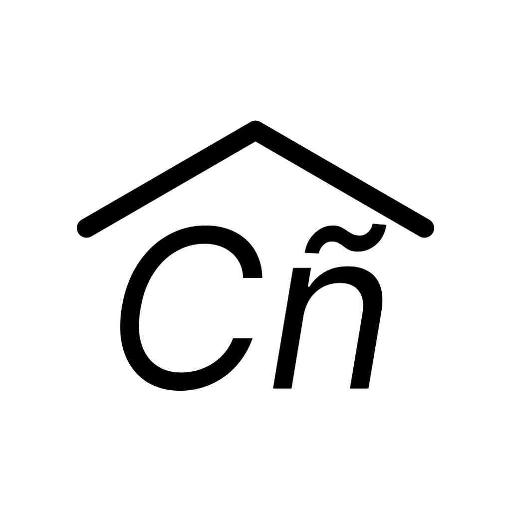
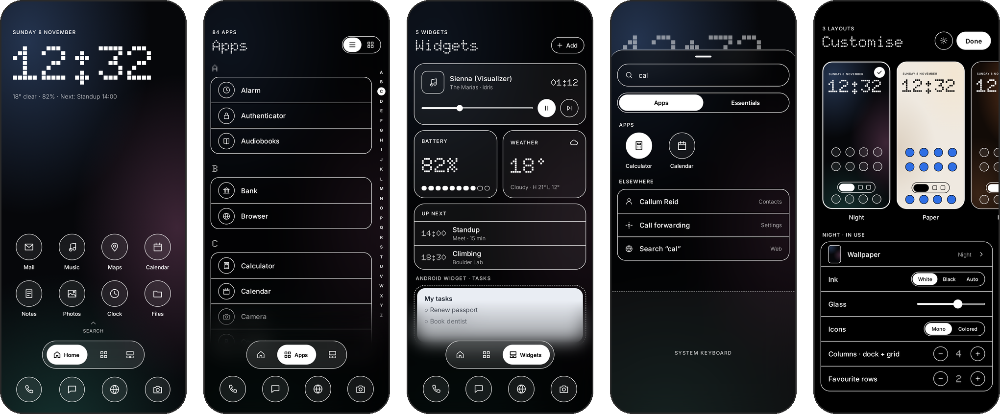
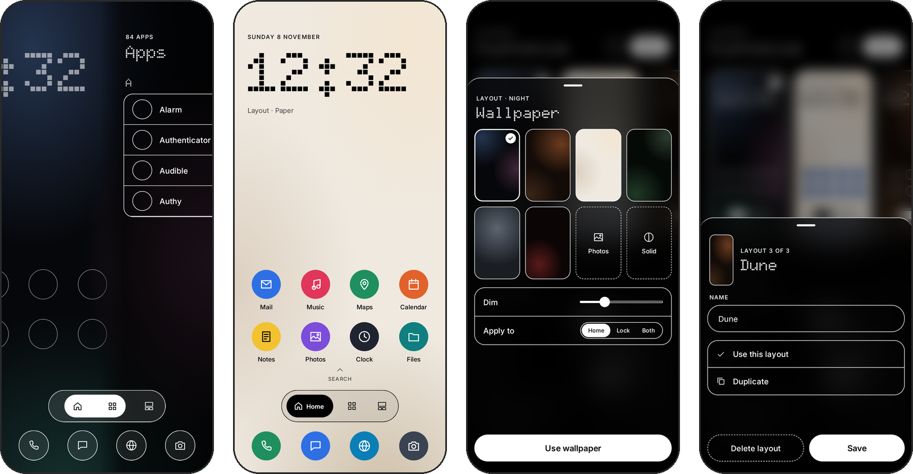
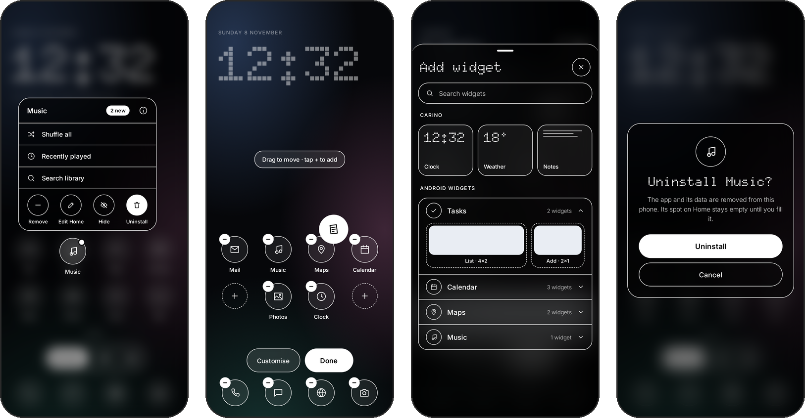
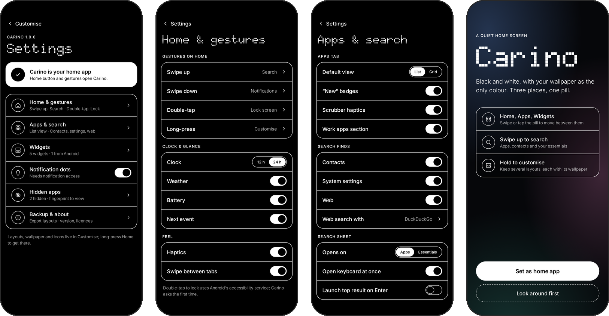
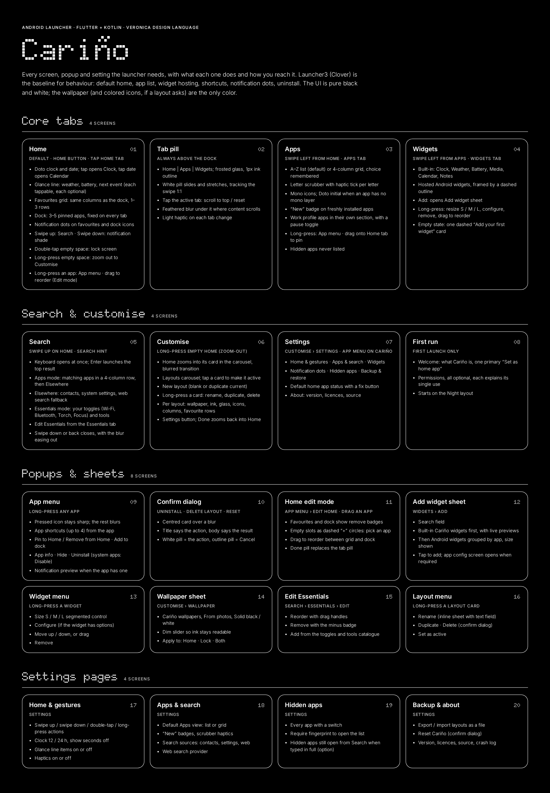
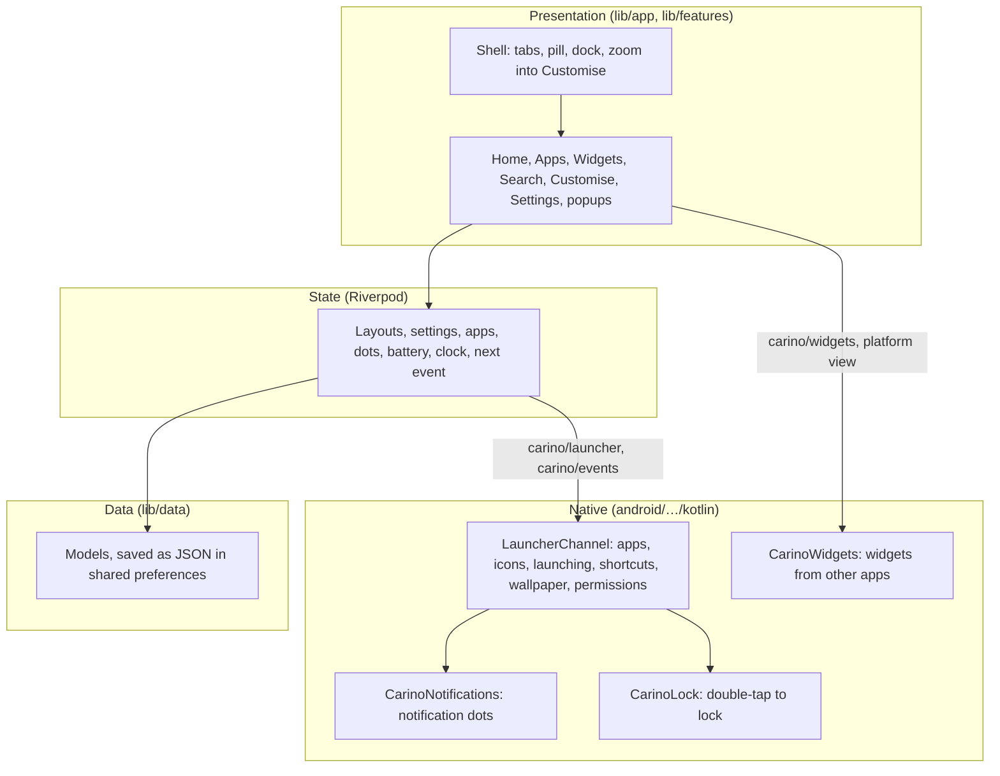

<div align="center">



# Cariño

**A quiet Android home screen. Black and white, with your wallpaper as the only colour.**


</div>

<p align="center">
  
</p>

---

## Why Cariño

> 'No One Noticed' & 'Sienna' are my favourites, but 'Cariño' suits as the name! Listen to The Marías, it'll change or ruin your life.

A home screen is the thing you see most on your phone, and most of them are loud: colour everywhere, badges, feeds, suggestions. Cariño is a launcher that gets out of the way. It draws everything in black and white ink over your wallpaper, so the one colourful thing on the screen is the picture you chose.

There are only three places, **Home**, **Apps** and **Widgets**, under one glass pill. Home is a clock, a few favourites and a dock. Everything else is a swipe or a long-press away.

### Principles

| Principle | What it means in practice |
| --- | --- |
| **Your wallpaper is the colour** | The interface is pure black and white: white ink on dark wallpapers, black on light ones. App icons are monochrome unless a layout asks for colour. |
| **Calm** | No feeds, no suggestions, no badges but a single dot. Motion is short and soft; glass and blur instead of panels. |
| **Light on the phone** | Nothing redraws in the background, the clock ticks once a minute, blurs are made once and saved, and the app list and icons are cached. |
| **Private** | No account, no analytics. Calendar and contacts are optional and only read on the phone. The one thing that ever uses the internet is weather, off until you turn it on. |

Cariño's design language is Veronica's, carried over from [Idris](https://github.com/isg32/idris): pure black and white, the Doto dot-matrix face with Inter, 1 px ink outlines and frosted glass. [Launcher3](https://github.com/The-Clover-Project/packages_apps_Launcher3) is the reference for what a launcher has to do; the interface is Cariño's own.

> The app is called **Cariño**; the package and code names stay `carino` (`com.isg32.carino`).

---

## Features

| Area | What it does |
| --- | --- |
| **Home** | Doto clock and date, battery and your next calendar event, a favourites grid that shares the dock's columns, the dock. Swipe up for Search, down for notifications, double-tap to lock, long-press for Customise, spread two fingers for hidden apps. Edit mode to add, remove and drag apps. |
| **Pill** | Home · Apps · Widgets in a glass capsule. The white pill follows your swipe between tabs. |
| **Apps** | Every app A–Z as a list or a grid, a letter scrubber with haptics, "New" badges and a Work section. Long-press any app for its shortcuts, Add to Home, Hide, Uninstall and App info. |
| **Notification dots** | A single ink dot on apps with notifications, counted the way Launcher3 does: only apps that allow dots, never ongoing ones. |
| **Search** | One field, two modes: your apps, people, system settings ("wifi", "battery") and the web; or your Essentials, quick toggles and tools you choose and order. Swipe down to close. |
| **Widgets** | Cariño's own Now playing (any app's music, with progress, pause and next), Up next (today's events and your next alarm), Clock, Weather, Battery, Calendar and Notes widgets, and widgets from your other apps in their own colours inside a dashed frame. Add, resize, configure, reorder, remove. |
| **Customise** | Long-press Home and it zooms out into its own card. Keep several layouts, each with its own wallpaper (built-in, or your photos with dim and blur), ink, glass strength, mono or coloured icons, frosted icon backgrounds, columns and favourite rows. |
| **Hidden apps** | Hide any app. Spread two fingers on Home and enter your passcode to open them as a folder. |
| **Weather** | Optional, off by default: the temperature and sky on Home and a Weather widget, from Open-Meteo (no account or key). Only the place's coordinates are sent, at most every 30 minutes, while Cariño is on screen. The place is a city you search for, or the phone's last known approximate one; never GPS. |
| **Wallpaper** | Changes the moment you choose it and cross-fades in. Android's own wallpaper follows the layout as a soft blurred copy, so Recents and app transitions match. |
| **Opening apps** | Apps slide in from the right while Cariño blurs behind them, and un-blur when you come back. |
| **First run** | Set Cariño as your home app, then a single page of optional permissions, each turning on one thing. |
| **Crash reports** | An unexpected error shows a calm popup with the log, *Copy log* and *Save to Downloads*. A crash on the Android side is shown on the next launch. As in Idris. |
| **Settings** | Gestures, clock and glance line, Apps and Search options, web search engine, hidden apps and passcode, backup, reset, About. |

---

## Screens

**Layouts.** The pill follows the swipe between tabs, and each layout carries its own wallpaper, ink and icons: here a light "Paper" layout with coloured icons, the wallpaper sheet and the layout menu.

<p align="center">
  
</p>

**Popups.** Every popup blurs what is behind it. Long-press an app for its menu; edit Home by dragging; add widgets; confirm before anything is removed.

<p align="center">
  
</p>

**Settings and first run.**

<p align="center">
  
</p>

**The map.** Every screen, popup and setting, with what each one does and how you reach it, as planned on the design canvas.

<p align="center">
  
</p>

These are renders of the design, made in Claude Design.

---

## Architecture

Cariño is a Flutter app (Cupertino widgets only, no Material) with a thin native Kotlin layer for what a home app needs from Android.



**Presentation.** One shell holds the three tabs in a page view with the pill and dock over them. Customise sits behind the shell: long-pressing Home scales the whole scene into its card in the layouts carousel, with a blur riding the motion. Every popup goes through one route that blurs what is behind it.

**State.** Layouts and settings are Riverpod notifiers saved as JSON. The app list, notification dots, battery, torch and default-home status are streams fed by the native layer, so a change anywhere reaches every screen showing it.

**Native layer.** Two platform channels: `carino/launcher` for calls (list apps, render icons, launch, shortcuts, uninstall, set the wallpaper, permissions, calendar and contacts) and `carino/events` for what Android tells Cariño (Home pressed, packages changed, battery, notification dots, resume). Icons are rendered once and cached on disk; the app list is cached so Home appears at once after a reboot.

**Wallpapers.** Cariño draws its own wallpaper so its glass can blur it. Every view shares one decoded image, a new wallpaper cross-fades in once decoded, and photo blurs are rendered once to a file. Android's wallpaper is kept in step as a blurred copy at a quarter of the screen size.

### Enforced rules

Checked by tests on every run:

- **Two colours.** A colour may only be created in `lib/core/theme/v_colors.dart` (the built-in wallpapers live there too), and importing Material fails the build.
- **Every screen opens.** A smoke test opens every page, sheet and tab (Customise included) on a phone-sized view with white ink and with black ink, against a mocked Android, and fails on any exception or layout overflow.
- **The shown version matches `pubspec.yaml`.**

---

## Project structure

```text
carino/
├── lib/
│   ├── main.dart                 Entry point: edge to edge, wallpaper decoded before the first frame
│   ├── app/                      Root, shell (tabs, pill, dock, Customise zoom), opening blur
│   ├── core/                     Veronica's design system: tokens, colours, glass, controls, icons
│   ├── data/                     Models and Riverpod providers
│   ├── features/
│   │   ├── home/                 Home, the favourites grid and dock, gestures
│   │   ├── apps/                 The Apps tab
│   │   ├── widgets/              Cariño's widgets
│   │   ├── search/               Search, Essentials, system settings
│   │   ├── customise/            Layouts, wallpaper and layout sheets
│   │   ├── menus/                App menu, app picker
│   │   ├── vault/                Hidden apps and the passcode
│   │   ├── settings/             Settings pages and About
│   │   ├── onboarding/           Welcome, permissions and the boot loading screen
│   │   └── common/               Wallpaper, app icons, popups, the loader
│   └── platform/                 The Dart side of the native layer, and the crash log
├── android/app/src/main/kotlin/com/isg32/carino/
│   ├── MainActivity.kt           The home activity
│   ├── LauncherChannel.kt        Everything Cariño asks of Android
│   ├── CarinoNotifications.kt    Notification dots
│   ├── CarinoLock.kt             Double-tap to lock
│   ├── CarinoWidgets.kt          Widgets from other apps
│   ├── CarinoMedia.kt            Now playing
│   └── CrashFiles.kt             Native crashes, saving logs to Downloads
├── assets/                       Fonts (OFL), the app icon sources, the About photo
├── docs/screenshots/             README images, rendered from the design
└── test/                         The colour rule, the version check and the smoke test
```

---

## Getting started

### Requirements

- Flutter 3.47 or later (Dart 3.13)
- Android SDK 36 and JDK 17
- A phone on Android 8.0 (API 26) or newer

### Build and run

```sh
flutter pub get
flutter analyze
flutter test
flutter run --release        # with the phone connected over USB debugging
```

Then press Home and choose Cariño, or use Settings › Default home app.

### Optional permissions

Each one turns on a single thing, and Cariño works without any of them:

| Permission | For |
| --- | --- |
| Notification access | Notification dots |
| Accessibility ("Cariño: double-tap to lock") | Locking the screen on a double-tap; it reads nothing |
| Calendar | The next event on Home |
| Contacts | People in Search |
| Approximate location | Weather "here", if you choose it over a city |

### Signed releases

Release APKs are signed with a key that never enters the repository.

- **Locally:** copy `.env.example` to `.env`, which is gitignored. Put the keystore in it base64-encoded (`base64 -w0 release-key.jks`) with its passwords, then run `./build_signed.sh`. The keystore is decoded to a temporary file for the build and deleted afterwards.
- **On GitHub:** every push to `main` runs `.github/workflows/release.yml`. It tests, builds and signs one APK per ABI and publishes them as a release tagged `v<version>-<short sha>`. Set `CARINO_KEYSTORE_BASE64`, `CARINO_KEYSTORE_PASSWORD`, `CARINO_KEY_PASSWORD` and, optionally, `CARINO_KEY_ALIAS` as secrets in a `deployment` environment.

Without these, release builds fall back to the debug key.

### Installing a release

Signed APKs are attached to every [release](https://github.com/isg32/carino/releases). For most phones, use `app-arm64-v8a-release.apk`. What changed in each one is in the [changelog](CHANGELOG.md).

---

## Development

- **Commits.** History is linear on `main`; each commit is one change with a message that says why, and passes `flutter analyze` and `flutter test`.
- **App icon.** Sources are in `assets/icon/`. Run `dart run flutter_launcher_icons` after changing them.
- **Design.** The screens were designed on the "Carino screens" canvas in Claude Design, in Veronica's design language. The images in `docs/screenshots/` are rendered from it.

Issues and pull requests are welcome.

---

## License

Copyright (C) 2026 Sapan Gajjar

Cariño is free software: you can redistribute it and/or modify it under the terms of the [GNU General Public License v3.0](LICENSE) as published by the Free Software Foundation. It is distributed in the hope that it will be useful, but WITHOUT ANY WARRANTY; without even the implied warranty of MERCHANTABILITY or FITNESS FOR A PARTICULAR PURPOSE. See the [LICENSE](LICENSE) for details.

Bundled fonts keep their own licences: Doto and Inter under the SIL Open Font License ([`assets/fonts/`](assets/fonts/)).
